# Component guide — Core Agentic website mockups

These notes explain every major component in the image boards. The image sequence follows the approved strategy. The final color authority is **#044EFF**; the supplied logo is preserved.

Image-generated screens communicate visual intent. Exact copy, numbers, accessibility and behavior in this guide take precedence over any raster rendering irregularity. Embedded app views are concepts with sample information.

## 01. Homepage — opening and problem

Route: `/ (upper)` · [Open image](../images/01-home-opening.png)

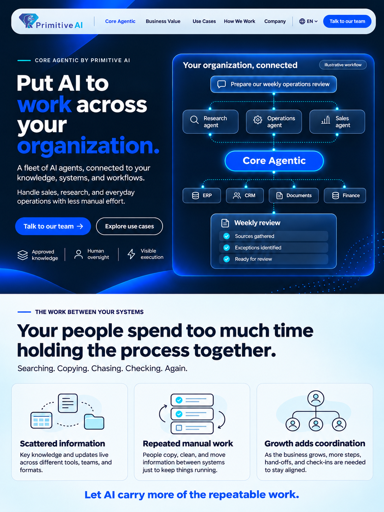

| ID | Component and location | Purpose | Behavior and content requirements |
|---|---|---|---|
| G01 | **Floating navigation** — Top capsule | Preserve recognizable navigation and the unchanged full-color logo; keep one clear contact action. | Logo returns home; active route is selected; Core Agentic opens a concise menu including Trust & Control; language selector preserves the current route. |
| H01 | **Headline and actions** — Hero, left | Establish what Core Agentic does in one glance. | Primary: Talk to our team → /contact. Secondary: Explore use cases → /use-cases. Headline stays real HTML text during implementation. |
| H02 | **Connected work illustration** — Hero, right | Show a request, configured agent roles, approved systems and a reviewable output. | Illustrative marketing diagram. Animated routes are optional; all meaning remains visible when motion is disabled. |
| H02a | **Control cues** — Below hero actions | Introduce approved knowledge, human oversight and visible execution. | Link the cue group to /trust; icons accompany text and do not carry meaning alone. |
| H02b | **Operational bottlenecks** — Light section | Make scattered information, repeated work and coordination costs recognizable. | Three informative cards; no compulsory click or carousel. Stack on mobile. |

## 02. Homepage — business value and use cases

Route: `/ (middle)` · [Open image](../images/02-home-value-and-use-cases.png)

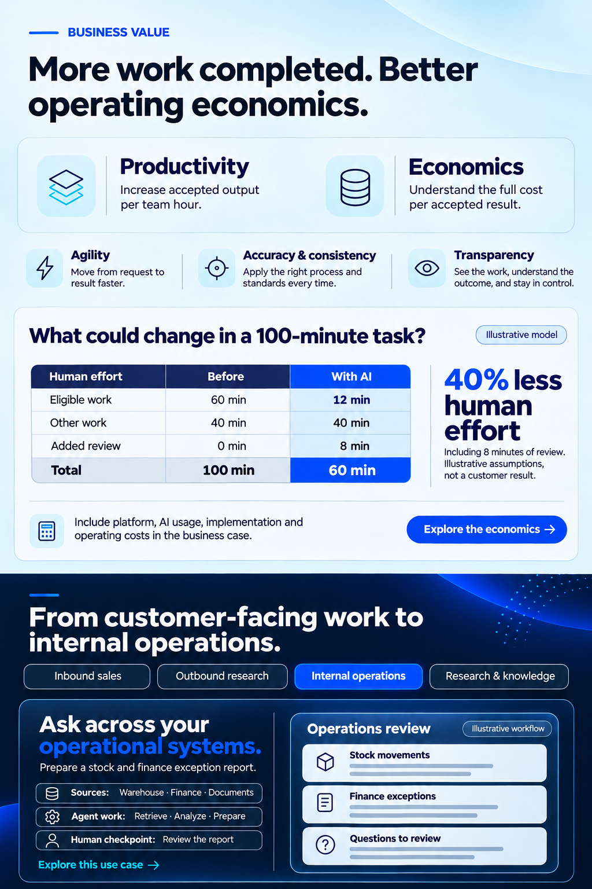

| ID | Component and location | Purpose | Behavior and content requirements |
|---|---|---|---|
| H03 | **Business-value hierarchy** — Upper light section | Prioritize productivity and economics, with agility, accuracy and transparency supporting them. | Copy describes intended outcomes; measured claims require their own evidence. |
| H03a | **Illustrative effort comparison** — Middle comparison panel | Explain a 100-minute baseline becoming 60 human minutes after assistance, including review. | Use the pictured comparison table: before 60 eligible + 40 other + 0 added review = 100; assisted 12 remaining + 40 other + 8 review = 60. The result is 40% less human effort. |
| H03b | **Economics link** — Below comparison | Move interested buyers to the full model. | Explore the economics → /business-value. Treat recovered capacity and total financial savings separately. |
| H04 | **Use-case tabs** — Lower navy section | Let visitors recognize relevant work without reading every application. | Tabs: Inbound sales, Outbound research, Internal operations, Research & knowledge. Internal operations is the pictured selection. |
| H04a | **Scenario and output** — Selected tab panel | Connect a specific request to sources, agent contribution, human review and an output. | Illustrative workflow label stays visible; Explore this use case opens the equivalent section on /use-cases. |

## 03. Homepage — delivery, platform, company and closing

Route: `/ (lower)` · [Open image](../images/03-home-delivery-platform-and-closing.png)

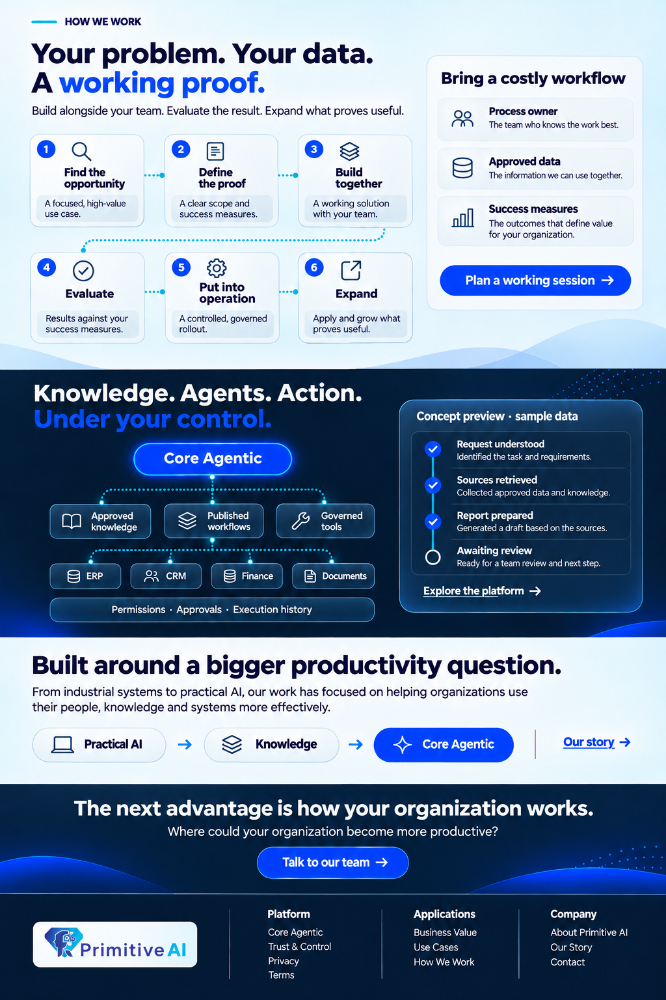

| ID | Component and location | Purpose | Behavior and content requirements |
|---|---|---|---|
| H05 | **Delivery overview** — First section | Explain how a business problem becomes a working proof and then an operating capability. | Six stages link to /how-we-work; the working-session CTA goes to /contact with inquiry intent, without invented duration or price. |
| H05a | **Preparation card** — Beside the process | Make the first engagement concrete. | Show process owner, approved data and success measures; no sensitive file-upload request on the public form. |
| H06 | **Platform explanation** — Navy section | Substantiate the business story with knowledge, orchestration, workflows, connections and controls. | Keep authoritative systems separate. Explore the platform → /core-agentic. |
| H06a | **Execution concept** — Beside architecture | Show user-visible steps and review points. | Label as concept preview with sample data. This is not an authentic product screenshot or a disclosure of hidden model reasoning. |
| H07 | **Founder-story bridge** — Light editorial section | Connect practical experience to the productivity mission. | Our story → /company. Use real approved portraits only during implementation. |
| H08 | **Closing invitation** — Final navy section | Invite a useful conversation after the business story. | Talk to our team → /contact. Avoid guaranteed competitive outcomes. |
| G02 | **Footer** — Bottom | Provide platform, application, company and policy navigation. | Use approved contact details only; keep other products secondary according to their actual commercial role. |

## 04. Core Agentic — platform and orchestration

Route: `/core-agentic` · [Open image](../images/04-core-agentic-platform.png)

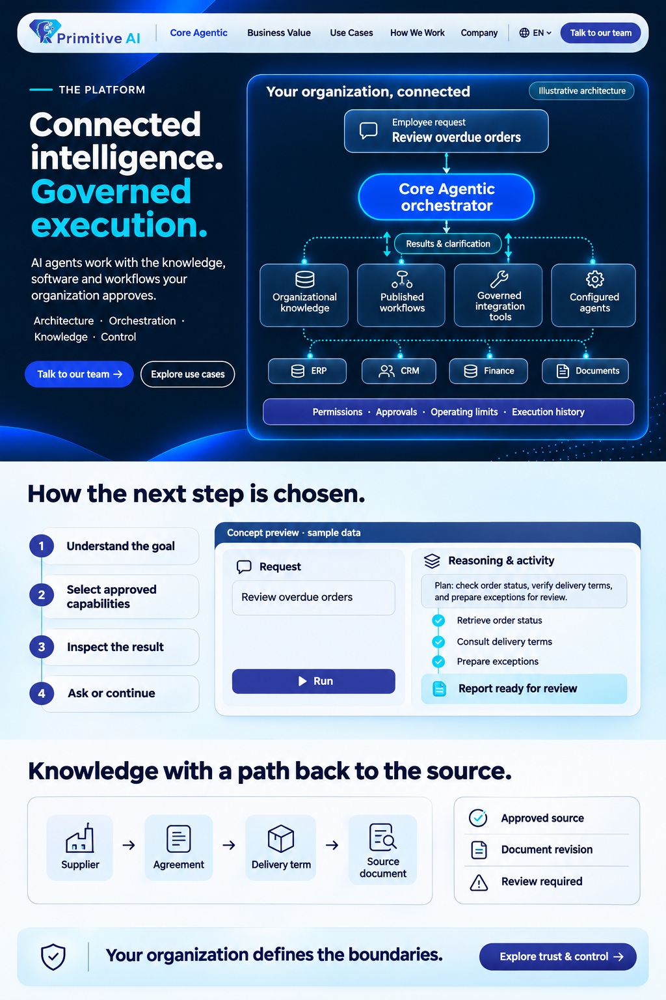

| ID | Component and location | Purpose | Behavior and content requirements |
|---|---|---|---|
| P01 | **Platform introduction and anchors** — Top | Orient a technical evaluator without losing the business context. | Anchor links scroll to sections with header offset; selected anchor uses text and underline as well as color. |
| P02 | **Architecture graph** — Dominant central diagram | Show the orchestrator selecting knowledge, workflows, tools and configured agents under shared controls. | Include result and clarification feedback. Do not represent agents as arbitrary workflow nodes or show unlimited authority. |
| P03 | **Orchestration story** — Light lower section | Explain goal understanding, capability selection, result inspection and clarification. | An illustrative order-review example; availability depends on configured and qualified capabilities. |
| P03a | **Activity preview** — Beside orchestration | Make planning narration, tool activity and review state understandable. | Use the Concept preview · sample data label. Replace with a qualified real screenshot when the exact scenario is verified. |
| P04 | **Knowledge and source trail** — Bottom section | Connect organizational relationships to inspectable source evidence. | Source revision and access boundaries remain meaningful; graph grounding does not guarantee correctness. |

## 05. Business Value — economics worksheet

Route: `/business-value` · [Open image](../images/05-business-value-and-economics.png)

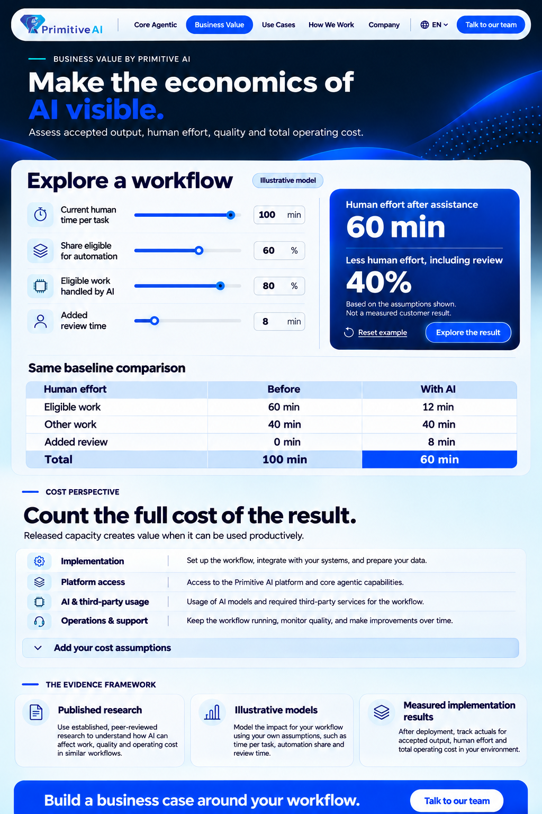

| ID | Component and location | Purpose | Behavior and content requirements |
|---|---|---|---|
| V01 | **Business-value introduction** — Top | Explain the evaluation basis: accepted output, effort, quality and total cost. | Use no unverified headline performance number. |
| V02 | **Model inputs** — Worksheet, left | Make assumptions editable and visible. | Baseline 100 min; eligible share 60%; AI-handled eligible work 80%; review 8 min. Every slider also has a keyboard-operable numeric field. |
| V03 | **Modeled result** — Worksheet, right | Translate assumptions into understandable human effort. | 100 × (1 − .60 × .80) + 8 = 60 minutes. 40% less human effort. Label illustrative, not a product result. |
| V03a | **Effort comparison table** — Below worksheet | Make the baseline and assisted effort directly comparable without relying on raster chart proportions. | Exact rows: eligible work 60/12 min; other work 40/40 min; added review 0/8 min; total 100/60 min. Keep semantic table headers and readable units. |
| V04 | **Full-cost section** — Lower content | Include implementation, platform, usage, operations and support in the evaluation. | Cost assumptions are optional. Do not assume released hours are payroll reductions; avoid counting the same value twice. |
| V05 | **Evidence distinctions** — Bottom | Separate research, models and measured implementation evidence. | Each research claim needs its study context; each customer result needs baseline, scope, period and permission. |

## 06. Use Cases — internal operations example

Route: `/use-cases#internal-operations` · [Open image](../images/06-use-case-operations.png)

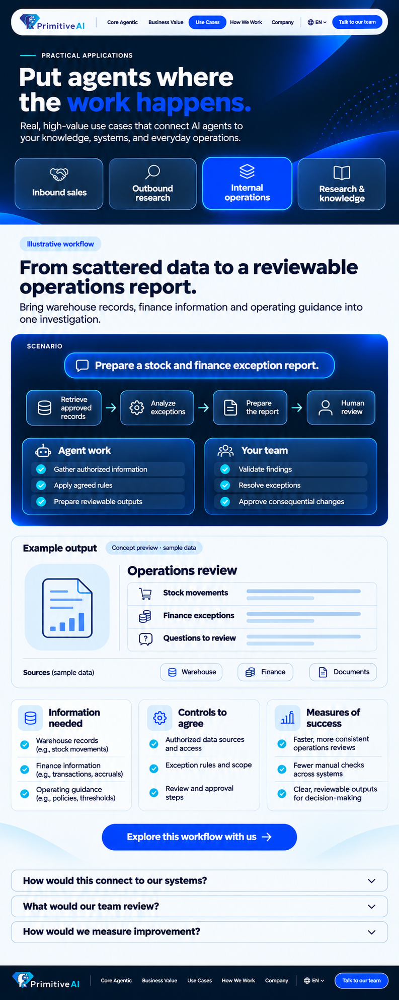

| ID | Component and location | Purpose | Behavior and content requirements |
|---|---|---|---|
| U01 | **Application navigation** — Top tabs | Help buyers select a recognizable job. | Use tabs with keyboard arrows on desktop; a clear selector or stacked navigation on narrow screens. |
| U02 | **Concrete scenario** — Main case header | Explain the starting task and intended reviewable outcome. | Keep the illustrative-workflow label and exact evidence status. |
| U03 | **Work and human responsibilities** — Process panel | Distinguish agent contribution from team accountability. | Retrieve → analyze → prepare → human review. Consequential system changes require applicable policy and authorization. |
| U04 | **Output concept** — Adjacent preview | Show what the team will receive. | Readable operations-review sections without fictional customer statistics; conceptual output is clearly labeled. |
| U05 | **Prerequisites and measures** — Lower columns and FAQs | Make feasibility and evaluation discussable. | Information needed, controls to agree, measures of success; inquiry CTA carries selected use-case context. |

## 07. How We Work — working proof to operation

Route: `/how-we-work` · [Open image](../images/07-how-we-work.png)

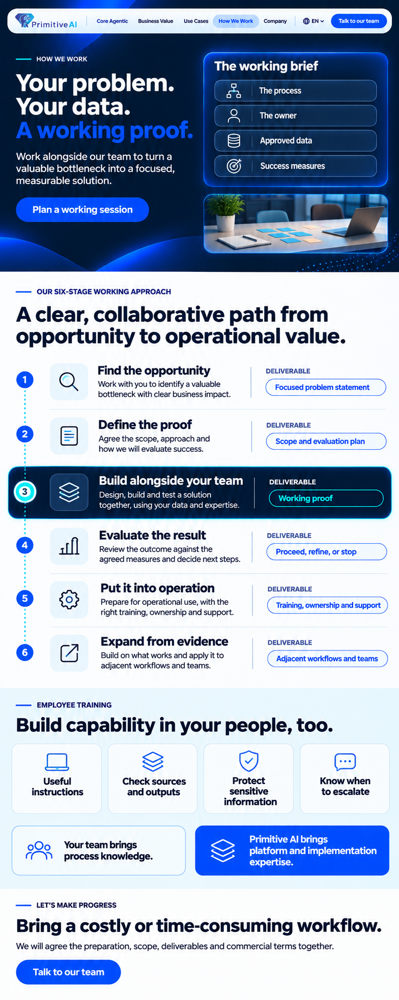

| ID | Component and location | Purpose | Behavior and content requirements |
|---|---|---|---|
| W01 | **Working-proof invitation** — Top | Offer a focused path from a valuable bottleneck to evidence. | Plan a working session → /contact. Scope, preparation and terms are agreed; no automatic free or five-day offer. |
| W02 | **Working brief** — Hero, right | Show what the customer helps define. | Process, owner, approved data and success measures are preparation prompts, not a data-upload interface. |
| W03 | **Delivery stages** — Main vertical path | Set expectations for proof, evaluation, operation and expansion. | Proceed, refine or stop is an explicit evaluation decision. A successful proof is not the same as a qualified production release. |
| W04 | **Workforce enablement** — Training band | Make practical AI literacy part of adoption. | Useful instructions, verification, sensitive information, permissions and escalation; role-specific learning. |
| W05 | **Shared responsibility and inquiry** — Bottom | Clarify who contributes and what happens next. | Customer supplies process knowledge and business validation; Primitive AI supplies agreed platform and implementation work. |

## 08. Trust & Control — authority and oversight

Route: `/trust` · [Open image](../images/08-trust-and-control.png)

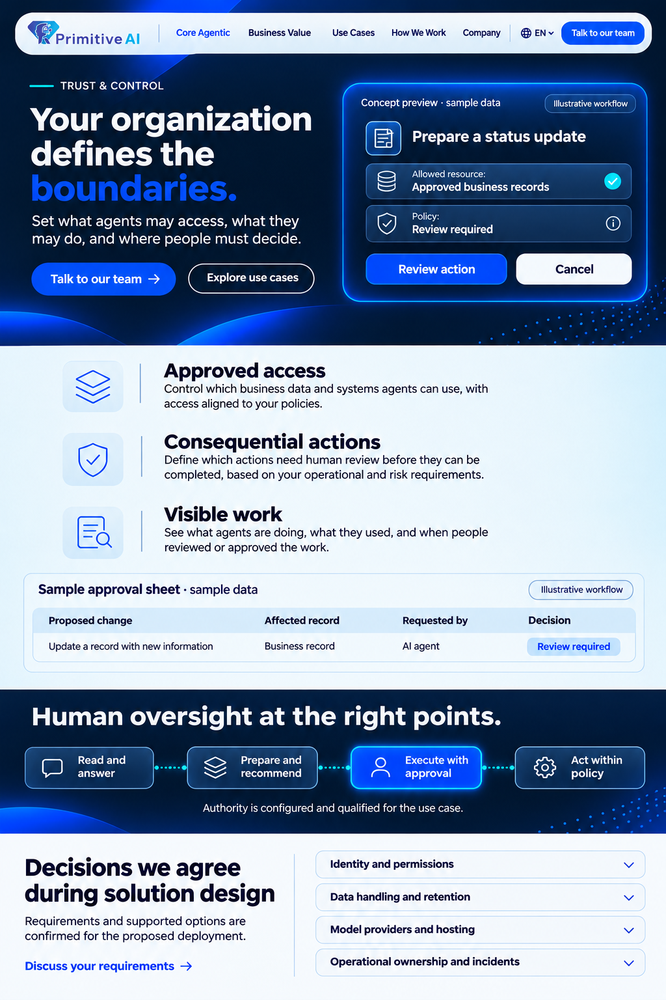

| ID | Component and location | Purpose | Behavior and content requirements |
|---|---|---|---|
| T01 | **Trust introduction** — Top | Explain authority in concrete terms. | Access, action and decision rights are configured for the user and use case. |
| T02 | **Control principles** — Main editorial rows | Make approved access, consequential actions and visible work easy to assess. | Use precise examples without certification or compliance promises. |
| T03 | **Approval concept** — Sample interface | Show the actual change and decision point a person should inspect. | Concept preview only. Real implementation must bind approval to the exact action and respect cancel/reject semantics. |
| T04 | **Authority progression** — Navy band | Show how responsibility can expand deliberately. | Read; prepare; execute with approval; act within policy. This is not a compulsory automation ladder or access grant. |
| T05 | **Deployment questions** — Lower accordions | Identify choices agreed during solution design. | Identity, retention, models, hosting and operational ownership. Confirm supported choices before publication. |

## 09. Company — mission and founder journey

Route: `/company` · [Open image](../images/09-company-and-founder-story.png)

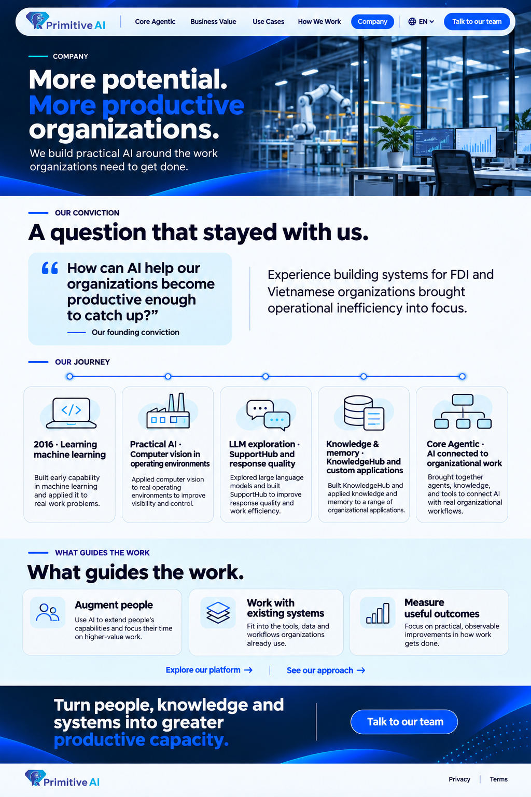

| ID | Component and location | Purpose | Behavior and content requirements |
|---|---|---|---|
| C01 | **Company mission** — Hero | Establish Primitive AI's purpose and practical focus. | Generic contextual imagery must not be represented as a real customer site. |
| C02 | **Founding question** — Editorial section | Give the productivity mission personal meaning. | Present as the founder's conviction rather than an economic research finding. |
| C03 | **Learning and product journey** — Timeline | Connect education, practical AI, response quality, knowledge research and Core Agentic. | 2016 is the confirmed learning year. Avoid invented launch dates and role chronology. |
| C04 | **Operating principles and invitation** — Bottom | Connect mission to practical company behavior. | Augment people, use existing systems, measure useful outcomes. Links to platform and delivery pages. |

## 10. Contact — plan a working session

Route: `/contact` · [Open image](../images/10-contact-working-session.png)

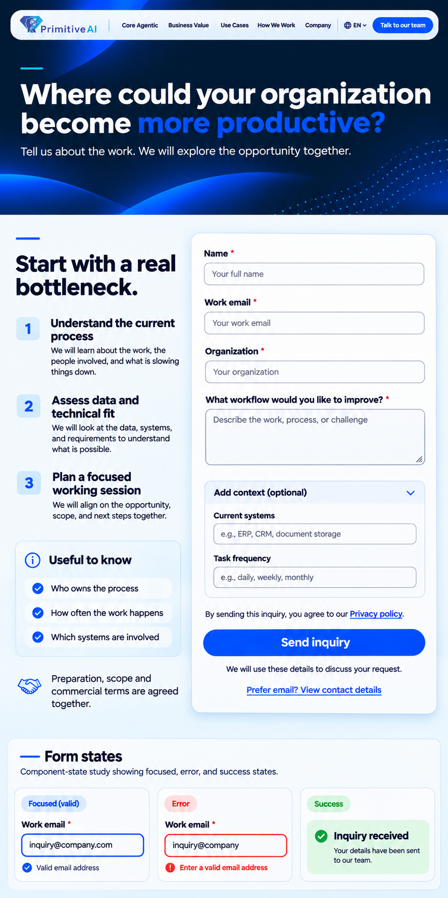

| ID | Component and location | Purpose | Behavior and content requirements |
|---|---|---|---|
| F01 | **Contact invitation** — Top | Ask about an organizational problem rather than a generic technology purchase. | Explain that the first discussion assesses fit and a possible working session. |
| F02 | **What happens next** — Left panel | Reduce uncertainty and prepare a useful conversation. | Process understanding, data/technical fit, scoped next step; no unconfirmed response-time promise. |
| F03 | **Core inquiry fields** — Right form | Collect only the information needed to respond. | Name, work email, organization and workflow description. Persistent visible labels; do not use placeholder text as the label. |
| F04 | **Optional context** — Disclosure | Let a prepared buyer add systems and task frequency without burdening everyone. | Optional fields stay optional. Preserve input through validation errors. |
| F05 | **Validation and receipt states** — Bottom study strip | Define focus, error and success behavior before implementation. | The strip is a design study, not a simultaneous live form state. Show receipt only after a real server or service accepts the submission. |

## 11. Mobile — homepage, value, use case and menu

Route: `Responsive / multiple states` · [Open image](../images/11-mobile-responsive-and-navigation.png)

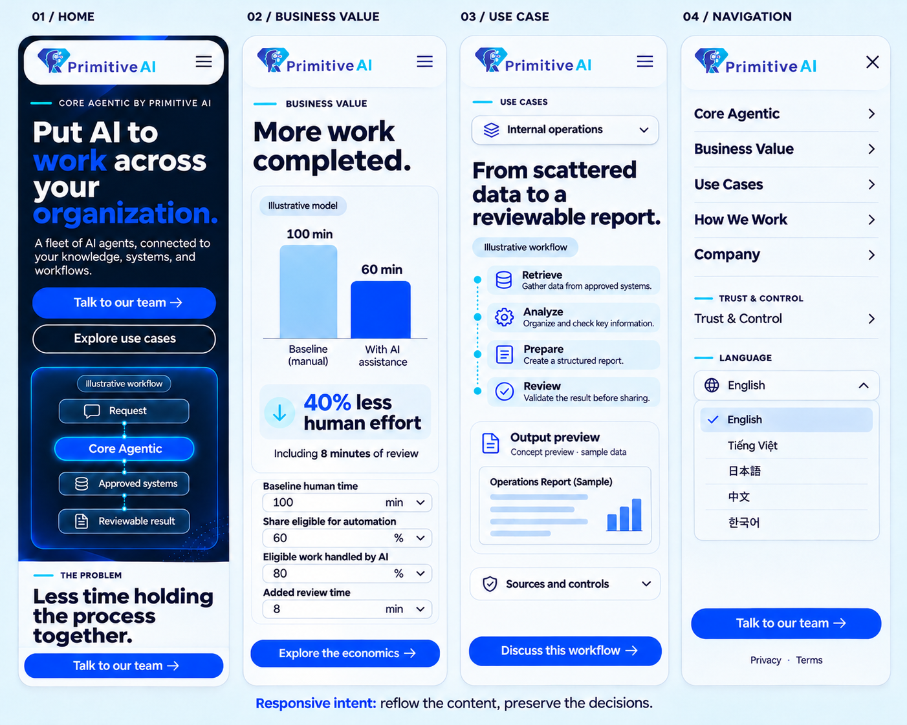

| ID | Component and location | Purpose | Behavior and content requirements |
|---|---|---|---|
| M01 | **Mobile header and hero** — Screen 1 | Preserve the headline and main decision in a narrow layout. | Full-color logo on light capsule; open menu; two stacked actions; 44–48 px hit areas. |
| M02 | **Simplified diagram and sticky action** — Screen 1, lower | Reflow meaning rather than shrinking desktop art. | Request → Core Agentic → approved systems → reviewable result. Sticky action respects safe area and never covers content. |
| M03 | **Mobile economics** — Screen 2 | Keep assumptions and results readable. | The mobile worksheet uses the same four assumptions as desktop: baseline 100 min, eligible share 60%, AI-handled eligible share 80%, added review 8 min. The displayed assisted total is 60 min, including review. |
| M04 | **Mobile use-case detail** — Screen 3 | Let users understand the scenario and human checkpoints. | Vertical steps, disclosure for sources/controls, clear contextual CTA. |
| M05 | **Full-height navigation** — Screen 4 | Provide complete route and language access. | Visible close button, Escape support, focus trap while open, restore focus to trigger, correct scroll locking and safe areas. |

